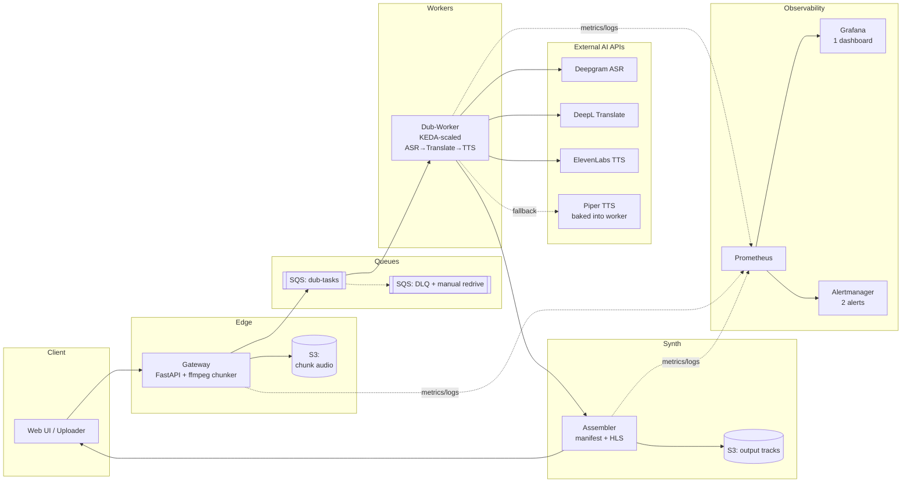

# Lingofy — Real-Time Multilingual Audio Dubbing Platform

> A cloud-native pipeline that ingests uploaded audio, splits it into 8s chunks,
> dubs each chunk through one KEDA-scaled worker (ASR → Translate → TTS with
> Piper fallback), and reassembles synchronized multilingual tracks under a
> **p95 end-to-end latency SLO of 3 seconds** — with one Grafana dashboard,
> two alerts, and one cost panel.

**Implementation of the YouTube auto-dub feature, built as a DevOps engineering project.**

> **Scope:** this repo implements the MVP in `docs/plan.md` — 3 services, 1 work queue + DLQ, 1 dashboard, dumb fallback. Anything bigger lives in **§15 Future Scope**, not in the build.

---

## 1. Why this project exists

YouTube's auto-dub is, at its core, a thin AI layer — ASR → translation → TTS,
all of which are black-box model calls — wrapped in a large distributed-systems
problem: how do you slice audio, fan chunks out to workers, keep every
language track in sync with the original timeline, hold a latency SLO while
calling unreliable paid APIs, and keep the per-minute cost bounded?

Lingofy builds that wrapper. The AI models are **rented HTTP endpoints**; every
interesting engineering decision here is about orchestration, scaling,
resilience, observability, and cost.

## 2. Architecture at a glance (MVP)



See `docs/architecture.md` for the layered view and `docs/TECHNICAL_REFERENCE.md` for service specs. Build steps: `docs/plan.md`.

## 3. Components (MVP — 3 images)

| Component           | Tech                                                     | Responsibility                                                                                              | Scales via                                                       |
| ---------------------| ----------------------------------------------------------| -------------------------------------------------------------------------------------------------------------| ------------------------------------------------------------------|
| **Gateway**         | FastAPI + ffmpeg + Python                                | Sessions, upload ingest, 8s silence-snapped chunking, status/manifest                                       | 1 replica (MVP — avoids SQLite split-brain; HPA is future scope) |
| **Dub-Worker**      | Python + Deepgram/DeepL/ElevenLabs SDKs + Piper baked in | One chunk in → ASR → Translate (1→N langs) → TTS sequentially, with stage timers                            | KEDA on `dub-tasks` depth (`queueLength: 5`, min 1 max 8)        |
| **Assembler**       | Python + ffmpeg                                          | Reorder by `seq`, `atempo` align, emit HLS playlists + manifest                                             | HPA on CPU (1–2 pods)                                            |
| **Provider helper** | `providers.py` inside worker (not a separate service)    | 2 retries w/ jitter, dumb breaker (3 fails → fallback 60s), `chars_billed` reporting                        | —                                                                |
| **Queues**          | SQS ×2                                                   | `dub-tasks` (visibility 60s, maxReceive 3) + `lingofy-dlq` (manual redrive)                                 | managed                                                          |
| **Object store**    | S3                                                       | Chunk WAVs, per-language MP3s, playlists, manifests                                                         | managed                                                          |
| **Observability**   | Prometheus, Grafana, Alertmanager                        | One dashboard (SLO + stages + scaling + cost), two alerts (SLOBurn, DLQNonEmpty), JSON logs with `chunk_id` | static                                                           |
| **Cost counter**    | Prometheus counter in worker                             | `cost_cents_total` from `prices.yaml` → one cost panel                                                      | in-worker                                                        |

## 4. End-to-end data flow (MVP)

1. Client creates a session → gateway returns `session_id` and an upload URL (or a WebSocket for live mic skeleton).
2. Gateway chunks the audio into **8-second segments** at silence boundaries (`ffmpeg silencedetect`, fallback `-f segment`), writes each chunk to S3 with `{session_id, chunk_id, seq, start_ms, end_ms}`, and enqueues one message per chunk on `dub-tasks`.
3. Dub-workers (KEDA-scaled on `dub-tasks` depth) each take one chunk: Deepgram ASR → DeepL Translate (fan-out to `es,hi`) → ElevenLabs TTS. If ElevenLabs fails 3 times in a row, that worker uses **baked-in Piper** for 60s, then retries primary. Each stage is timed into `stage_duration_seconds{stage}`.
4. Per-language MP3s land in S3; the **Assembler** polls every 10s, reorders by `seq`, time-stretches with `atempo 0.9–1.1` when dubbed/source differ >12%, and publishes **`playlist.m3u8` per language** + `manifest.json`. A chunk missing past 90s is marked `unavailable`, never blocking.
5. Client polls `GET /sessions/{id}/manifest` or plays `playlist.m3u8` directly.

Correlation key is `chunk_id` in every log line and metric label.

## 5. Latency budget (p95 = 3.0 s, clock: enqueue → playable)

SLO clock: **enqueue → dubbed chunk playable.** Upload time is excluded and reported separately as `upload_seconds` — a 5-min MP3 over slow Wi-Fi must not blow the SLO. Run the SLO demo on a pre-uploaded sample.

| Stage | Budget | Notes |
|---|---|---|
| Ingest + chunk | 150 ms | local ffmpeg op inside gateway |
| Queue wait (avg) | 700 ms | single KEDA queue keeps backlog near zero |
| ASR (streaming Deepgram) | 400 ms | streaming endpoint <300 ms; pre-recorded REST avoided (can exceed 20 s) |
| Translation | 250 ms | DeepL REST |
| TTS | 700 ms | ElevenLabs; Piper fallback similar or faster |
| Reassembly + manifest | 200 ms | local poll + ffmpeg |
| Margin / retries | 600 ms | absorbed by 2 retries |
| **Total** | **3 000 ms** | SLOBurn alert fires if p95 > SLO for 5 min |

## 6. Key design decisions (ADR summary)

| # | Decision | Alternative rejected | Why |
|---|---|---|---|
| ADR-1 | **k3s on a single EC2** | EKS ($73/mo idle) | Full K8s semantics at free-tier cost |
| ADR-2 | **SQS (2 queues) over Kafka** | MSK ($540+/mo) | 1M free req/mo; 1 work queue + DLQ covers MVP scale |
| ADR-3 | **Chunk-parallel, not session-parallel** | One worker per session | Chunks are the uniform scaling unit |
| ADR-4 | **Provider helper as module in worker** | Separate AI Gateway service | No second caller in MVP; extract when one appears |
| ADR-5 | **Piper baked into worker as TTS fallback** | ElevenLabs-only | Free, unlimited, zero extra deployment; live kill-provider demo |
| ADR-6 | **8s chunks** | 2s (too many API calls) / 30s (latency floor too high) | Balances call overhead vs time-to-first-audio |
| ADR-7 | **HLS for output** | Raw WAV download | Progressive playback before session completes |
| ADR-8 | **3 deployments, not 7** | Service per AI stage | Same histogram data with stage timers, ~half the ops load |

Language choice: **Python 3.12 mono-stack** (one base image, `ruff + pytest`, first-class provider SDKs; SLO is provider-bound so glue overhead is single-digit ms).

## 7. SLOs (MVP — 2 alerts)

| SLO | Target | Measured by |
|---|---|---|
| End-to-end chunk latency (enqueue → dubbed chunk playable; upload excluded) | p95 < 3 s | `lingofy_session_e2e_latency_seconds` → alert SLOBurn |
| Pipeline completeness | DLQ stays empty | `lingofy_dlq_messages_total` → alert DLQNonEmpty |
| Timeline drift | ≤ 250 ms | `lingofy_drift_ms` (panel, no page) |
| Cost per minute of audio | reported | `lingofy_cost_cents_total` (panel, no page) |

## 8. Cost model (summary)

- **AWS**: k3s on 1× t3.micro free tier → **$0**; SQS + S3 free tiers → $0. Demo EKS burst optional ≈ $12 one-time.
- **ASR**: Deepgram **$200 free credit**; Whisper $0.006/min flagged off by default.
- **Translation**: DeepL Free 500K chars/mo.
- **TTS**: ElevenLabs free ~10K chars/mo; **Piper default → unlimited, $0**.
- **Per 5-min EN → ES+HI**: ≈ $0.00–0.06 via Piper; ≈ $0.80 fully paid.

Full detail: `docs/TECHNICAL_REFERENCE.md` §11.

## 9. Tech stack (MVP)

`Python 3.12 · FastAPI · ffmpeg · boto3 · k3s/k3d · KEDA (1 ScaledObject) · Helm ·
GitHub Actions · Trivy · Prometheus · Grafana (1 dashboard) · Alertmanager (2 alerts) ·
k6 · AWS (SQS ×2, S3, ECR, IAM)`

Stretch only (timeboxed, drop on friction): ArgoCD sync replacing `helm upgrade`, cosign signing (Trivy stays regardless).

## 10. Repository layout (MVP)

```
lingofy/
├── README.md
├── docs/
│   ├── TECHNICAL_REFERENCE.md
│   ├── architecture.md
│   ├── plan.md
│   └── runbook.md
├── services/
│   ├── gateway/        # app.py + chunker.py + static UI
│   ├── dub-worker/     # worker.py + providers.py + prices.py + Piper voices
│   └── assembler/      # assemble.py (poll S3, atempo, HLS)
├── deploy/
│   ├── helm/lingofy/   # umbrella + 3 subcharts, values-dev/demo
│   ├── keda/           # 1 ScaledObject + TriggerAuthentication
│   ├── observability/  # dashboard.json (1) + alerts.yaml (2)
│   └── terraform/      # S3×2, SQS×2+DLQ, ECR×3, IAM (~200 lines)
├── .github/workflows/  # ci.yaml, cd.yaml
├── tests/
│   ├── unit/  integration/  load/
└── scripts/            # demo.sh, load.sh, chaos/kill-worker.sh, chaos/block-provider.sh
```

## 11. Quickstart (local)

```bash
# 1. Local cluster
k3d cluster create lingofy

# 2. Local infra emulators
docker compose -f deploy/dev/docker-compose.yml up -d   # localstack(SQS/S3), prom, grafana

# 3. Deploy the platform
helm dependency update deploy/helm/lingofy
helm upgrade --install lingofy deploy/helm/lingofy -f deploy/dev/values.yaml

# 4. Run the demo
./scripts/demo.sh samples/sample-en-5min.mp3 --targets es,hi
# → prints URLs for each language HLS playlist + Grafana dashboard link
```

## 12. Demo scenarios (five moments)

1. **Play.** Upload 5-min EN → ES+HI; first dubbed chunk plays < 3 s, rest streams.
2. **Hold SLO.** Grafana shows E2E p95 vs 3s + per-stage bars.
3. **Scale.** k6 burst (30–50 sessions); KEDA 1→8 on queue depth, drains back.
4. **Kill provider.** Block ElevenLabs mid-demo; fallback counter rises, Piper audio continues, zero drops. Then `kubectl delete pod` mid-stream; redelivery completes manifest, DLQ stays empty.
5. **Cost.** Same dashboard: Piper route ≈ $0 vs paid route ≈ $0.80 for the same clip.

## 13. Team

| Member | Role | Owns |
|---|---|---|
| Aarav Chaturvedi | Backend & DevOps | Terraform, KEDA, Helm, CI/CD, cost counter |
| Abhinav Singh | Backend & AI Infra | Gateway + chunker, dub-worker, providers, Piper |
| Anshuman Tripathi | Frontend & Testing | Web UI, k6 load, chaos scripts, dashboard |

## 14. Glossary

**Chunk** — 8s audio segment; unit of parallelism. **Session** — one source
audio + N target languages. **Dumb breaker** — 3 fails → fallback 60s, retry once.
**DLQ** — dead-letter queue (manual redrive). **E2E latency** — upload start → dubbed chunk playable.

## 15. Future Scope (not built now)

Split worker per AI stage with stage queues; AI Gateway as separate service; OTel manual traces (Tempo/Jaeger); dashboards 2–4 and extra alerts (StageFailureSpike, CircuitOpen states, CostAnomaly); 3-state breaker with half-open probing; per-tenant budget guards + anomaly detection; DLQ auto-redrive Jobs; nightly chaos workflow; ArgoCD as primary deploy; cosign signing; Go live-relay; kubebuilder TTL operator; voice cloning, diarization, lip-sync, multi-node, WebRTC SFU, multi-region. Each maps to a row in `docs/plan.md` §"What was cut" with its defense line.
