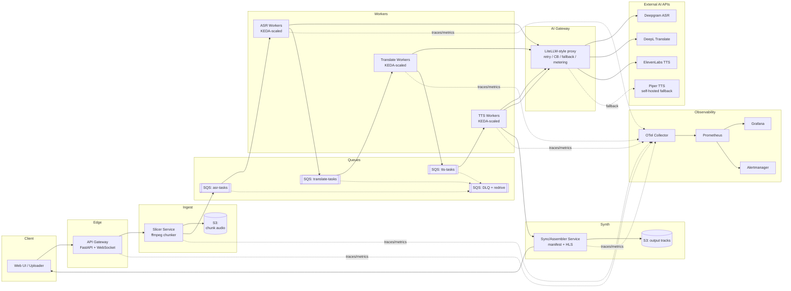

# Lingofy — Real-Time Multilingual Audio Dubbing Platform

> A cloud-native streaming pipeline that ingests live or uploaded audio, shards it
> into chunks across an autoscaling worker fleet on Kubernetes, orchestrates
> third-party AI APIs through a resilience gateway, and reassembles synchronized
> multilingual tracks under a **p95 end-to-end latency SLO of 3 seconds** —
> instrumented end-to-end with OpenTelemetry, monitored in Prometheus/Grafana,
> chaos-tested for provider outages, and profiled per-tenant for AI spend.

**Implementation of the YouTube auto-dub feature, built as a DevOps engineering project.**

---

## 1. Why this project exists

YouTube's auto-dub is, at its core, a thin AI layer — ASR → translation → TTS,
all of which are black-box model calls — wrapped in a large distributed-systems
problem: how do you slice live audio, fan it out to parallel workers, keep every
language track in sync with the original timeline, hold a latency SLO while
calling unreliable paid APIs, and keep the per-minute cost of doing so bounded?

Lingofy builds that wrapper. The AI models are **rented HTTP endpoints**; every
interesting engineering decision in this repo is about orchestration, scaling,
resilience, observability, and cost.

## 2. Architecture at a glance



See `docs/architecture.md` for the layered view and `docs/TECHNICAL_REFERENCE.md` for the full implementation spec.

## 3. Components

| Component | Tech | Responsibility | Scales via |
|---|---|---|---|
| **API Gateway** | FastAPI + WebSocket | Session lifecycle, upload/stream ingest, status queries | HPA on CPU |
| **Slicer** | ffmpeg + Python | Split audio into 8s chunks with timeline metadata | HPA on CPU |
| **ASR Worker** | Python + Deepgram SDK | Speech→text per chunk | KEDA on `asr-tasks` depth |
| **Translate Worker** | Python + DeepL SDK | Text translation per chunk | KEDA on `translate-tasks` depth |
| **TTS Worker** | Python + ElevenLabs / Piper | Speech synthesis per chunk | KEDA on `tts-tasks` depth |
| **AI Gateway** | LiteLLM proxy | Retries w/ jittered backoff, circuit breaker, provider fallback, token metering | static (1–2 pods) |
| **Sync/Assembler** | Python + ffmpeg | Order chunks, align to original timeline, emit manifest + HLS playlists | HPA on CPU |
| **Queues** | AWS SQS ×4 (+DLQ) | Stage-to-stage fan-out with per-message visibility & redrive | managed |
| **Object store** | S3 | Chunk audio, synthesized audio, manifests | managed |
| **Observability** | OTel Collector, Prometheus, Grafana, Alertmanager | Traces per chunk, RED metrics per stage, SLO dashboards & alerts | static |
| **Cost Meter** | Prometheus exporter | Tokens/chars billed per tenant per provider → cost panels | in-gateway |

## 4. End-to-end data flow

1. Client creates a session → gateway returns `session_id` and a signed S3 upload URL (or a WebSocket for live mic).
2. Slicer pulls the audio, chunk into **8-second segments** at silence boundaries where possible (`ffmpeg silencedetect` + `-f segment`), and writes each chunk to S3 with a manifest record `{session_id, chunk_id, seq, start_ms, end_ms}`.
3. Slicer enqueues a **ChunkCreated** message per chunk on `asr-tasks`.
4. ASR workers (KEDA-scaled on queue depth) consume, call Deepgram via the AI Gateway, emit **TranscriptionDone** onto `translate-tasks`.
5. Translate workers call DeepL, emit **TranslationDone** onto `tts-tasks` (one message per target language).
6. TTS workers synthesize per language — ElevenLabs for quality, **Piper as a self-hosted fallback** when the circuit breaker opens or quota is exhausted.
7. Every synthesized chunk lands in S3; the **Sync/Assembler** consumes completion events, reorders by `seq`, aligns durations to the original timeline (time-stretch ±10% if needed), and publishes an **HLS playlist per language** plus a session manifest.
8. The client polls `GET /sessions/{id}/manifest` or plays `playlist.m3u8` directly.

A single OpenTelemetry trace spans all seven steps for every chunk, with the
`chunk_id` as the correlation key.

## 5. Latency budget (p95 = 3.0 s)

| Stage | Budget | Notes |
|---|---|---|
| Ingest + chunk | 150 ms | local ffmpeg op |
| Queue wait (avg) | 700 ms | KEDA keeps backlog near zero |
| ASR (streaming Deepgram) | 400 ms | streaming endpoint returns transcripts in <300 ms; pre-recorded endpoint can exceed 20 s and is avoided for live paths |
| Translation | 250 ms | DeepL REST |
| TTS | 700 ms | ElevenLabs; Piper is faster but lower quality |
| Reassembly + manifest | 200 ms | local op |
| Margin / retries | 600 ms | absorbed by one retry per stage |
| **Total** | **3 000 ms** | alert fires if p95 > SLO for 5 min |

## 6. Key design decisions (ADR summary)

| # | Decision | Alternative rejected | Why |
|---|---|---|---|
| ADR-1 | **k3s on a single EC2** | EKS ($73/mo control plane, billed idle) | Full K8s semantics at free-tier cost; EKS revisited only for demo week |
| ADR-2 | **SQS over MSK/Kafka** | MSK ($540+/mo minimum) | 1M free SQS requests/mo; queue semantics + DLQ + redrive cover our scale |
| ADR-3 | **Chunk-parallel, not stream-parallel** | One worker per session | Chunks are the unit of scaling; N sessions × 8s chunks → uniform queue depth |
| ADR-4 | **AI Gateway as a separate service** | SDK calls inside workers | One place for retries, circuit breaking, fallback, and cost metering; workers stay dumb |
| ADR-5 | **Piper self-hosted as TTS fallback** | ElevenLabs-only | Free, unlimited, zero-latency-bandwidth dependency; graceful degradation story |
| ADR-6 | **8s chunks** | 2s (too many API calls) / 30s (latency floor too high) | Balances per-call overhead against time-to-first-dubbed-audio |
| ADR-7 | **HLS for output** | Raw WAV download | Progressive playback possible before full session completes |

Language choice: **Python 3.12 mono-stack for v1** (SDK coverage + velocity; SLO is provider-bound). Optional bounded Go microservice for the live-audio WebSocket relay in weeks 9–10. See `docs/architecture.md` §6.

## 7. SLOs

| SLO | Target | Measured by |
|---|---|---|
| End-to-end chunk latency (upload start → dubbed chunk playable) | p95 < 3 s | `lingofy_session_e2e_latency_seconds` |
| Stage success rate | ≥ 99.5% per stage | `lingofy_stage_duration_seconds_count` vs failures |
| Dubbed-chunk timeline drift vs original | ≤ 250 ms | assembler metric |
| Availability (gateway) | 99% monthly | uptime probe |
| Cost per minute of source audio | tracked, no SLO — reported | `lingofy_cost_cents_total` |

Error budget: 0.5% of chunks per rolling week may breach the latency SLO before
feature work is frozen (documented in the runbook).

## 8. Cost model (summary)

- **AWS**: k3s on 1× t3.micro free tier (750 h/mo) → **$0**; SQS free tier → $0; S3 free tier → $0. Demo-week EKS burst optional ≈ $12 one-time.
- **ASR**: Deepgram **$200 free credit** (no card); OpenAI Whisper at $0.006/min as paid fallback.
- **Translation**: DeepL API Free **500,000 chars/month**; Google Translate 500K free chars/month as fallback.
- **TTS**: ElevenLabs free ~10K chars/month; **Piper self-hosted → unlimited, $0**.
- **Per 5-min video dubbed into 2 languages**: ~$0.06 with free tiers + Piper; ~$0.80 if fully on paid APIs.

Full detail: `docs/TECHNICAL_REFERENCE.md` §11.

## 9. Tech stack

`Python 3.12 · FastAPI · ffmpeg · boto3 · LiteLLM · k3s · KEDA · Helm · ArgoCD ·
GitHub Actions · Trivy · cosign · OpenTelemetry · Prometheus · Grafana · Alertmanager ·
k6 · AWS (SQS, S3, ECR, IAM)`

## 10. Repository layout

```
lingofy/
├── README.md
├── docs/
│   ├── TECHNICAL_REFERENCE.md
│   ├── architecture.md
│   ├── plan.md            # derived from TECHNICAL_REFERENCE §12
│   └── runbook.md
├── services/
│   ├── gateway/
│   ├── slicer/
│   ├── worker-asr/
│   ├── worker-translate/
│   ├── worker-tts/
│   ├── ai-gateway/
│   └── assembler/
├── deploy/
│   ├── helm/              # one chart per service + umbrella
│   ├── keda/              # ScaledObjects, TriggerAuthentications
│   ├── observability/     # Prometheus rules, Grafana dashboards (JSON)
│   ├── argocd/            # Application manifests (GitOps)
│   └── terraform/         # S3, SQS, ECR, IAM (AWS-side only)
├── .github/workflows/     # ci.yaml, cd.yaml, chaos-nightly.yaml
├── tests/
│   ├── unit/  integration/  load/  chaos/
└── scripts/               # demo.sh, load.sh, destroy-demo-week.sh
```

## 11. Quickstart (local)

```bash
# 1. Local cluster
k3d cluster create lingofy

# 2. Local infra emulators
docker compose -f deploy/dev/docker-compose.yml up -d   # localstack(SQS/S3), otel, prom, grafana

# 3. Deploy the platform
helm dependency update deploy/helm/lingofy
helm upgrade --install lingofy deploy/helm/lingofy -f deploy/dev/values.yaml

# 4. Run the demo
./scripts/demo.sh samples/sample-en-5min.mp3 --targets es,hi
# → prints URLs for each language HLS playlist + Grafana dashboard link
```

GitOps variant (demo week): `kubectl apply -f deploy/argocd/` then `argocd app sync lingofy`.

## 12. Demo scenarios (what we show)

1. **Cold start → dubbed audio.** Upload 5-min EN clip, target ES+HI; show the
   first dubbed chunk playing in < 3 s and the rest streaming in progressively.
2. **Scale wall.** k6 drives 50 concurrent sessions; Grafana shows KEDA scaling
   ASR/TTS workers 1 → 12 on queue depth, then back to 1.
3. **Provider outage.** `iptables`-block ElevenLabs mid-demo; circuit breaker
   opens, traffic fails over to Piper, **no audio drops**, dashboard shows CB state flip.
4. **Chaos.** `kubectl delete pod` on a worker mid-stream; chunk retried from
   SQS visibility timeout, DLQ stays empty, output complete.
5. **Cost panel.** Same dashboard shows cost-per-minute-of-audio before and
   after enabling the phrase cache.
6. **Self-healing.** SLO burn auto-bumps KEDA maxReplicas; DLQ alert auto-redrives after provider recovery — Alertmanager webhook → remediation Job, visible on the wall.

## 13. Team

| Member | Role | Owns |
|---|---|---|
| Aarav Chaturvedi | Backend & DevOps | Queues, KEDA, Helm, ArgoCD, CI/CD, IaC, cost metering |
| Abhinav Singh | Backend & AI Infra | AI gateway, workers, provider integrations, tracing |
| Anshuman Tripathi | Frontend & Testing | Web UI, uploader, k6 load, chaos suite, dashboards |

## 14. Glossary

**Chunk** — 8s audio segment; unit of parallelism. **Session** — one source
audio + N target languages. **AI Gateway** — the single egress point for all
provider calls. **CB** — circuit breaker. **DLQ** — dead-letter queue.
**E2E latency** — upload start → dubbed chunk playable.
